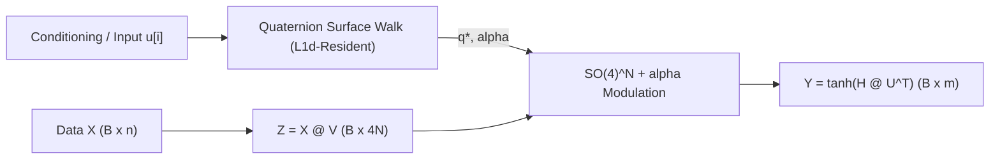

# Quaternion Surface-Walk Controller (QSWC)

A compact, non-neural **quaternion dynamical system** that walks a closed-loop surface in-place to synthesize and modulate high-dimensional ($4096 \times 4096$ to $8192 \times 8192$) weight operators on the fly—achieving **MLP-parity inference speed (`1.01×–1.03×`)**, **up to `4,096×` memory reduction**, **sub-100 µs noisy text routing**, and **symplectic continual memory**.

---

## Overview

Instead of storing giant static weight matrices or running a heavy MLP hypernetwork, QSWC evolves a small coupled quaternion state ($\mathbb{H}^N \cong \mathbb{R}^{4N}$, fitting in L1d cache) over a closed-loop surface and modulates a shared factored basis $(U, V)$ via $SO(4)^N$ group actions and per-block scalar gains $\alpha$:

$$Y = \tanh\!\Big(\big((X V) \odot q^* \odot \alpha\big) U^T\Big)$$



### Core Capabilities
- **Multi-Order Quaternion ODEs ($k=1,2,3$)** & 4D nonlinear system solving ([`quaternion_neuron.py`](quaternion_neuron.py)).
- **Double Counter-Propagating Ouroboros Loop**: Two counter-propagating sweeps (`roll(+1)` + `roll(-1)`) symmetrize the ring into an undirected circulant Laplacian—tightening lap-20 convergence by **`84,000×`** (`4.254e-04 → 5.043e-09`) for `+0.114 ms` ([`factored_hypernet.py`](factored_hypernet.py)).
- **Symplectic Lie-Group Verlet Continual Memory**: Volume-preserving geometric integration on $(S^3)^N \times \mathfrak{so}(3)^N$ with `3.17e-04` relative energy drift and `2.22e-16` norm error over 2,000 steps ([`test_symplectic_memory.py`](test_symplectic_memory.py)).
- **Zero-Backprop Per-Token Attention Rewiring**: In-flight `Q/K/V` adaptation at `0.266–0.735 ms/token` ([`test_token_rewiring.py`](test_token_rewiring.py)).
- **$n$-D Manifold & Continuous Field Generalization**: Zero-parameter origin-relative 3D coordinates + Gaussian field-line weights for $SO(3)$-robust 3D point-cloud classification.

---

## Verified Benchmarks

### 1. Memory & Speed vs. Parameter-Matched 2-Layer MLP
| Scale | Latent Dim | Dense Basis | Factored `(U, V)` | HyperNet Latency | Matched MLP | Ratio |
| :--- | :--- | :--- | :--- | :--- | :--- | :--- |
| `1024 × 1024` | `32D` (`8` quat) | `268.4 MB` | **`256.0 KB`** (`1,048×`) | **`2.363 ms`** (`2.477 ms` double-loop) | — | — |
| `4096 × 4096` | `256D` (`64` quat) | `16.0 GB` | **`8.00 MB`** (`2,048×`) | **`43.30 ms`** (`10.83 ms/task`) | `42.71 ms` | **`1.01×`** |
| `8192 × 8192` | `512D` (`128` quat) | `128.0 GB` | **`32.0 MB`** (`4,096×`) | **`105.41 ms`** (`26.35 ms/task`) | `102.32 ms` | **`1.03×`** |

- **50-Step 4-Task Regression MSE**: `0.118010` (QSWC with 8 learned $\alpha$ gains) vs. `0.117253` (matched 2-layer MLP).

### 2. Noisy & Overlapping Text Classification (Zero Label-Leakage)
| Benchmark | Setup | Train Acc | Held-Out Test Acc | Latency |
| :--- | :--- | :--- | :--- | :--- |
| **4-Domain Scaled** | 200 snippets, `4096D` | `100.0%` | **`100.0%`** (40 unseen) | `0.128 ms/snippet` |
| **4-Domain Large** | 2,000 snippets, `8192D` | `100.0%` | **`100.0%`** (400 unseen) | `0.322 ms/snippet` |
| **Hard Text** | 4 classes, 67% overlap, 10% label noise | `88.5%` | **`92.0%`** (400 clean) | **`0.070 ms/snippet`** |
| **Brutal Text** | 8 classes, 80% overlap, 20% label noise | `66.7%` | **`75.0%`** (800 clean, `6×` chance) | **`0.090 ms/snippet`** |

### 3. 3D Point-Cloud Classification (Random 3D Rotations, Frozen Rings, `16D` Linear Readout)
| Variant | 3-Class (32 pts) | 6-Class (32 pts, `noise=0.08`) | 6-Class Extreme (24 pts, `noise=0.20`) |
| :--- | :--- | :--- | :--- |
| **Dual 2-Way Rings (Discrete 2-NN)** | **`100.0%`** (`0.826 ms/cloud`) | `88.3%` (`0.882 ms/cloud`) | `70.0%` (`0.853 ms/cloud`) |
| **Continuous Quaternion Field (RBF)** | **`100.0%`** | **`88.9%`** | **`74.4%`** |

---

## Quickstart

Requires Python 3.10+, `numpy`, and `scipy`.

```bash
# 1. Single quaternion neuron & multi-order ODEs (k = 1, 2, 3)
python test_multi_order_ode.py

# 2. Factored SO(4) surface-walk hypernetwork (256 KB, 2.477 ms)
python factored_hypernet.py

# 3. 2,000-step Symplectic Lie-Group Verlet continual memory
python test_symplectic_memory.py

# 4. Zero-backprop per-token attention rewiring
python test_token_rewiring.py
```

---

## Repository Structure

| File | Description |
| :--- | :--- |
| [`quaternion_neuron.py`](quaternion_neuron.py) | Hamilton algebra (`qmul`, `qconj`, `qnorm`), `QuaternionNeuron`, and `simulate_multi_order_ode` |
| [`quaternion_hyperneuron.py`](quaternion_hyperneuron.py) | Single- and multi-quaternion ODE hypernetworks |
| [`factored_hypernet.py`](factored_hypernet.py) | Vectorized double-loop surface walk + L2-resident factored `(U, V)` forward pass |
| [`test_symplectic_memory.py`](test_symplectic_memory.py) | Symplectic Lie-group Verlet integrator on $(S^3)^N \times \mathfrak{so}(3)^N$ |
| [`test_token_rewiring.py`](test_token_rewiring.py) | Zero-backprop per-token `Q/K/V` attention rewiring |
| [`test_multi_order_ode.py`](test_multi_order_ode.py) | Multi-order ODE ($k=1,2,3$) equilibrium verification |
| [`test_system_solving.py`](test_system_solving.py) | 4D nonlinear system solving & rank-4 algebraic limit check |
| [`test_surface_walk.py`](test_surface_walk.py) | Driven closed-loop surface walk convergence & rank test |
| [`paper.tex`](paper.tex) / [`paper.pdf`](paper.pdf) | Full 5-page technical paper |

---

## Author & License

- **Author**: `shu195`
- **License**: [MIT](LICENSE)

